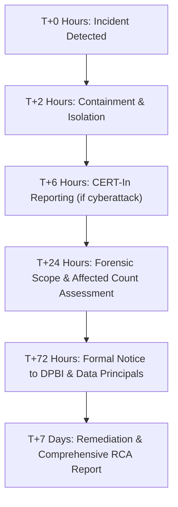

# PERSONAL DATA BREACH INCIDENT RESPONSE RUNBOOK
**Platform:** QR Print Seva (`qrprintseva.in`)  
**Statutory Framework:** Digital Personal Data Protection Act, 2023 (DPDP Act, Section 8(6)) & CERT-In Directions under Section 70B Information Technology Act, 2000.  
**Jurisdiction:** Gorakhpur, Uttar Pradesh, Republic of India.  
**Designated Incident Commander:** Data Protection & Grievance Redressal Officer (`dpo@qrprintseva.in`).  

---

## 1. PURPOSE & STATUTORY MANDATE

Under **Section 8(6) of the Digital Personal Data Protection Act, 2023**:
> *"In the event of a personal data breach, the Data Fiduciary shall give the Board and each affected Data Principal, intimation of such breach in such form and manner as may be prescribed."*

Under **CERT-In Cyber Security Directions (April 2022)**:
> Cybersecurity incidents meeting mandatory reporting criteria must be reported to the Computer Emergency Response Team (CERT-In) within **6 hours** of notice or detection.

This Runbook outlines the exact operational steps, timelines, and ready-to-use notice templates required when a confirmed or suspected personal data breach occurs.

---

## 2. SEVERITY CLASSIFICATION MATRIX

| Severity Level | Definition | Examples | SLA to DPBI | SLA to Data Principals |
| :--- | :--- | :--- | :--- | :--- |
| **SEV-1: CRITICAL** | Large-scale unauthorized exfiltration or exposure of customer personal files (Aadhaar, PAN, identity documents) or shopkeeper credential database. | Public database leak, server compromise with file cache dump, widespread ransomware on spoolers. | **Within 72 Hours** (Initial alert within 24h) | **Within 72 Hours** (Simultaneous with Board notice) |
| **SEV-2: HIGH** | Compromise of an individual shopkeeper's agent credentials, unauthorized access to a single shop's print queue, or localized payment UTR leakage. | Unauthorized local PC agent access, intercepted API token for a specific shop. | **Within 72 Hours** | **Within 72 Hours** to affected shopkeeper & their customers |
| **SEV-3: MEDIUM** | Transient file transmission misrouting without permanent storage or exploitation; isolated customer upload misdelivery. | Customer document spooled to wrong shop printer due to slug collision; immediately retrieved and shredded. | Document internally; notify Board if high risk of harm. | Notify affected customer within 5 days. |
| **SEV-4: LOW** | Non-PII telemetry leakage, DDoS on landing page, or blocked brute-force attempts without account penetration. | Rate-limiting trigger on login endpoint, failed SQLi probe against static endpoints. | Internal log only. No notification required. | None required. |

---

## 3. INCIDENT RESPONSE TIMELINE (STEP-BY-STEP)



### Phase 1: Triage & Identification (T+0 to T+2 Hours)
1. **Report Receipt:** Anyone identifying an anomaly alerts `dpo@qrprintseva.in` and `security@qrprintseva.in`.
2. **Declaration:** The Grievance & Data Protection Officer convenes the Incident Response Team (IRT).
3. **Log Locking:** Immediately freeze and snapshot:
   - Next.js server logs (`/api/orders`, `/api/agent/sync`).
   - Cloudflare / Vercel edge access logs.
   - Database and in-memory spooler state.
   - Do NOT reboot infected or compromised systems before taking forensic memory dumps.

### Phase 2: Containment & Isolation (T+2 to T+6 Hours)
1. Revoke all compromised API keys, shop tokens, and database credentials.
2. Invalidate active sessions for affected shopkeepers.
3. If print file pipeline is compromised, temporarily halt `/api/orders` POST ingestion and switch customer queue to offline cash notice.
4. If CERT-In mandatory criteria are met (ransomware, unauthorized data exfiltration, system intrusion), dispatch **CERT-In Initial Report within 6 hours**.

### Phase 3: Impact Assessment (T+6 to T+24 Hours)
1. Determine exact categories of data compromised:
   - Ephemeral customer print files (Aadhaar cards, resumes, exam admit cards).
   - Shopkeeper account details (Mobile number, shop name, UPI ID, password hash).
   - Financial identifiers (UTR transaction numbers).
2. Calculate the exact number of impacted Data Principals (Customers and Shopkeepers).
3. Assess the likelihood and severity of harm (identity theft, financial fraud, reputational damage).

### Phase 4: Statutory Reporting to the Data Protection Board of India (DPBI) (Within 72 Hours)
1. Complete **Template 1: Formal Notice to DPBI**.
2. Submit via the official DPBI digital regulatory portal and copy to `secretary@dpbi.gov.in`.
3. Obtain official DPBI Incident Tracking Reference Number.

### Phase 5: Notification to Affected Data Principals (Concurrent with Board Notice)
1. Transmit individualized notices via registered SMS, WhatsApp, and registered email using **Template 3 (Shopkeepers)** and **Template 4 (Customers)**.
2. Provide clear, actionable advice on protective measures (e.g. locking Aadhaar via UIDAI portal, rotating shop passwords).
3. Establish dedicated priority support helpline for affected citizens.

### Phase 6: Post-Incident Remediation & RCA (Within 14 Days)
1. Patch identified vulnerabilities.
2. Re-architect fail-open or vulnerable components to fail-safe zero-storage configurations.
3. Submit Final Remediation Closure Report to DPBI.

---

## 4. STATUTORY NOTIFICATION TEMPLATES

### TEMPLATE 1: FORMAL INTIMATION TO THE DATA PROTECTION BOARD OF INDIA (DPBI)
*(To be transmitted via official DPBI portal / email within 72 hours of incident confirmation)*

```text
To:
The Secretary,
Data Protection Board of India (DPBI),
New Delhi, Republic of India.

SUBJECT: INTIMATION OF PERSONAL DATA BREACH UNDER SECTION 8(6) OF THE DIGITAL PERSONAL DATA PROTECTION ACT, 2023

1. DATA FIDUCIARY PARTICULARS:
   - Legal Entity / Platform Name: QR Print Seva (qrprintseva.in)
   - Principal Office: Near Railway Station Road, Gorakhpur, Uttar Pradesh - 273001, India
   - Data Protection & Grievance Officer: Mr. Dhananjay Vishwakarma
   - Official Email: dpo@qrprintseva.in | Mobile: +91-7388688968

2. INCIDENT OVERVIEW:
   - Date & Time of Occurrence: [DD/MM/YYYY, HH:MM IST]
   - Date & Time of Confirmation: [DD/MM/YYYY, HH:MM IST]
   - Incident Severity: [SEV-1 Critical / SEV-2 High]
   - Nature of Incident: [Unauthorized Access / API Vulnerability / Ransomware / Infrastructure Misconfiguration]

3. SCOPE AND NATURE OF PERSONAL DATA INVOLVED:
   - Categories of Personal Data: [e.g., Shopkeeper contact data, mobile numbers, ephemeral print file payloads]
   - Estimated Number of Affected Data Principals: [Exact or Estimated Count]
   - Nature of Sensitive Identifiers Exposed: [Specify if Aadhaar, PAN, Voter ID, or bank UTR were involved]

4. TECHNICAL DETAILS AND ROOT CAUSE:
   - [Concise explanation of how the perimeter was compromised, e.g., compromised agent API endpoint, brute-forced token]

5. LIKELY CONSEQUENCES AND RISK ASSESSMENT:
   - Potential Impact on Data Principals: [Risk of identity spoofing, phishing, financial loss, etc.]

6. IMMEDIATE CONTAINMENT AND REMEDIAL MEASURES UNDERTAKEN:
   - [List actions: Token revocation, firewall rule injection, ephemeral memory purge, database isolation]

7. DATA PRINCIPAL COMMUNICATION PLAN:
   - [Confirm that affected Data Principals have been notified concurrently via SMS / Email on DD/MM/YYYY]

8. CONTACT FOR FURTHER INQUIRIES:
   - Dedicated Incident Response Desk: dpo@qrprintseva.in

Submitted with utmost respect,
For QR Print Seva,

[Authorized Signatory / Data Protection Officer]
Mr. Dhananjay Vishwakarma
Date: [DD/MM/YYYY]
```

---

### TEMPLATE 2: MANDATORY CYBER INCIDENT REPORT TO CERT-In
*(To be transmitted to incident@cert-in.org.in within 6 hours of cyber incident confirmation)*

```text
To:
Indian Computer Emergency Response Team (CERT-In),
Ministry of Electronics and Information Technology (MeitY),
Government of India.
Email: incident@cert-in.org.in | Hotline: 1800-11-4949

INCIDENT REPORTING FORM UNDER SECTION 70B OF THE IT ACT, 2000

1. Organization Name: QR Print Seva (qrprintseva.in)
2. Contact Person & DPO: Mr. Dhananjay Vishwakarma (dpo@qrprintseva.in)
3. Incident Type: [Unauthorized Access / Data Breach / Web Application Attack / Ransomware]
4. Date and Time of Incident Detection: [DD/MM/YYYY, HH:MM IST]
5. Affected IP Addresses / Domain: qrprintseva.in / api.qrprintseva.in (Vercel Edge & Cloudflare Proxies)
6. Description of Vulnerability / Attack Vector: [Detailed technical description]
7. Immediate Mitigations Taken: [Traffic blocked, tokens rotated, edge WAF rules applied]
8. Contact Number: +91-7388688968
```

---

### TEMPLATE 3: NOTICE TO AFFECTED SHOPKEEPERS (DATA PRINCIPALS)
*(To be dispatched via Registered Email, WhatsApp, and SMS)*

```text
Subject: [URGENT NOTICE] Important Security Alert Regarding Your QR Print Seva Account

Dear Shopkeeper Partner [Shop Name / Owner Name],

We are writing to inform you of a security incident that may have affected your QR Print Seva account details. We believe in total transparency and are providing this notice in strict compliance with Section 8(6) of the Digital Personal Data Protection Act, 2023.

WHAT HAPPENED?
On [DD/MM/YYYY], our security systems detected [brief description of incident: e.g. unauthorized attempt to access shop profile records]. We immediately contained the issue and engaged our security team to neutralize the threat.

WHAT DATA WAS INVOLVED?
The data involved may have included:
- Your Shop Name, Owner Name, Registered Phone Number, and Shop Address.
- Your Shop UPI VPA identifier.
IMPORTANT: Your payment credentials, customer bank accounts, and complete customer print files WERE NOT stored on our permanent servers due to our zero-storage architecture.

WHAT ACTIONS WE HAVE TAKEN:
1. We have neutralized the vulnerability and refreshed all security tokens.
2. We have formally notified the Data Protection Board of India (DPBI).
3. We have strengthened encryption protocols across our print agent pipeline.

WHAT YOU SHOULD DO:
1. Please log in to your dashboard and update your account password immediately.
2. Verify that your registered UPI ID in your dashboard settings is accurate.
3. Be cautious of any unsolicited WhatsApp messages or calls claiming to be from banks asking for OTPs.

DEDICATED SUPPORT:
If you have any questions or require assistance, please contact our Data Protection Officer directly:
- Name: Mr. Dhananjay Vishwakarma
- Email: dpo@qrprintseva.in
- Phone/WhatsApp Support: +91-7388688968

Sincerely,
Security & Data Privacy Team
QR Print Seva
```

---

### TEMPLATE 4: NOTICE TO AFFECTED PRINT CUSTOMERS (DATA PRINCIPALS)
*(To be dispatched via SMS & Email where contact details are available)*

```text
Subject: Important Privacy Notice Regarding Your Recent Print Order - QR Print Seva

Dear Citizen / Customer,

We are contacting you because you recently submitted a print order at one of our partner cyber cafe print shops ([Shop Name]).

WHAT HAPPENED?
On [DD/MM/YYYY], we identified a technical security incident affecting print queue transmission tokens. In accordance with Section 8(6) of the Digital Personal Data Protection Act, 2023, we are intimating you of this occurrence.

WAS YOUR DOCUMENT ARCHIVED?
Under QR Print Seva's Zero-Storage Architecture Guarantee, all customer print files are processed strictly in temporary volatile memory (RAM) and purged upon printing. No permanent copy of your uploaded document exists on our servers. However, during the transmission window, the file name ([File Name]) or transmission metadata may have experienced unauthorized observation.

WHAT ACTIONS WERE TAKEN?
- The transmission pipeline was immediately quarantined and secured.
- The incident has been reported to the Data Protection Board of India (DPBI).

RECOMMENDED PROTECTIVE STEPS:
- If your document was an Aadhaar card, we recommend utilizing UIDAI's official "Lock Aadhaar / Biometrics" feature on the mAadhaar app or resident portal (myaadhaar.uidai.gov.in) as a general best practice.
- Never share OTPs or banking PINs with anyone claiming to represent a print shop or payment gateway.

CONTACT US:
For any privacy questions or to exercise your rights under Chapter III of the DPDP Act 2023, reach out to our Grievance Officer:
- Email: dpo@qrprintseva.in | Portal: https://qrprintseva.in/privacy/rights

With regards,
Data Protection & Grievance Redressal Team
QR Print Seva (Gorakhpur, UP)
```

---

## 5. INCIDENT CONTACT DIRECTORY & ESCALATION MATRIX

| Role | Name | Channel | Response SLA |
| :--- | :--- | :--- | :--- |
| **Data Protection & Grievance Officer** | Mr. Dhananjay Vishwakarma | `dpo@qrprintseva.in` / +91-7388688968 | Immediate (Within 1 Hour) |
| **Security Engineering Lead** | Technical Team | `security@qrprintseva.in` | Immediate (Within 1 Hour) |
| **Legal Counsel** | Corporate Advocate | Legal Advisory Desk | Within 4 Hours |
| **Data Protection Board of India (DPBI)** | Central Regulatory Board | `secretary@dpbi.gov.in` / Digital Portal | Statutory: Within 72 Hours |
| **CERT-In Incident Desk** | National Incident Center | `incident@cert-in.org.in` / 1800-11-4949 | Statutory: Within 6 Hours |
